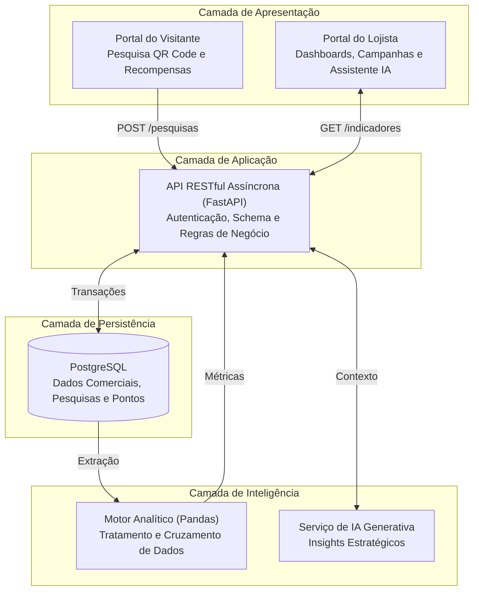

# VitrineIA — Documentação Técnica e Arquitetura da Solução

**Projeto:** VitrineIA — Inteligência Comercial para Lojistas  
**Etapa:** Primeira Entrega — Planejamento e Definição Técnica  
**Data da Entrega:** 13 de novembro de 2026  
**Organização:** Charizard-Rackarun  

---

## Sumário

1. [Visão Geral do Projeto](#1-visão-geral-do-projeto)
2. [Proposta e Estrutura Inicial das Telas](#2-proposta-e-estrutura-inicial-das-telas)
3. [Documentação Inicial do Projeto (Requisitos)](#3-documentação-inicial-do-projeto-requisitos)
4. [Linguagens de Programação Escolhidas](#4-linguagens-de-programação-escolhidas)
5. [Arquitetura Proposta](#5-arquitetura-proposta)
6. [Plataforma e Tecnologias Adotadas](#6-plataforma-e-tecnologias-adotadas)
7. [Incorporação da Tecnologia ou Prática Sorteada](#7-incorporação-da-tecnologia-ou-prática-sorteada)
8. [Governança e Tratamento de Dados](#8-governança-e-tratamento-de-dados)
9. [Estrutura dos Repositórios e Fluxo de Trabalho](#9-estrutura-dos-repositórios-e-fluxo-de-trabalho)
10. [Equipe e Responsabilidades](#10-equipe-e-responsabilidades)

---

## 1. Visão Geral do Projeto

### 1.1 Introdução

A VitrineIA é uma plataforma integrada de inteligência comercial e engajamento concebida para o ambiente de shopping centers. A solução atua como um ecossistema unificado que auxilia lojistas de diversos segmentos a compreenderem o comportamento dos consumidores, identificarem oportunidades de negócio e analisarem os fatores que influenciam o desempenho de seus estabelecimentos. Para alcançar esse propósito, a plataforma combina a análise avançada de dados comerciais com um sistema estruturado de coleta de informações e recompensas, fomentando a sinergia entre lojas e visitantes.

### 1.2 Identificação do Problema

O shopping reúne estabelecimentos de diferentes segmentos que atendem públicos com interesses e comportamentos variados. Nesse cenário, os lojistas enfrentam dificuldades para compreender de forma aprofundada o perfil dos consumidores que circulam pelo empreendimento, bem como para mapear oportunidades comerciais e identificar os fatores internos e externos que impactam diretamente o desempenho de suas operações.

### 1.3 Objetivo Geral

Melhorar a compreensão sobre o público consumidor e ampliar a identificação de oportunidades de negócio para os lojistas do shopping, utilizando coleta estruturada de dados, mecânicas de engajamento e inteligência artificial para gerar recomendações estratégicas e acionáveis.

### 1.4 Objetivos Específicos

* Centralizar e consolidar informações transacionais e de desempenho dos diferentes estabelecimentos do shopping.
* Capturar preferências, interesses e hábitos de consumo dos visitantes por meio de interações incentivadas por recompensas.
* Identificar padrões de comportamento do público, tendências de consumo e fatores que influenciam o desempenho comercial.
* Apresentar indicadores de desempenho e métricas de público por meio de painéis gerenciais interativos.
* Estimular a colaboração comercial por meio da sugestão de campanhas conjuntas, vendas cruzadas e parcerias estratégicas entre lojas de segmentos complementares.
* Gerar insights automatizados e recomendações comerciais fundamentadas em inteligência artificial.

---

## 2. Proposta e Estrutura Inicial das Telas

A plataforma foi projetada como uma aplicação web responsiva em Next.js, adaptada para dispositivos móveis (consumidores) e computadores ou tablets (lojistas), dividida em dois ecossistemas integrados:

### 2.1 Ecossistema do Visitante (Acesso Público via QR Code)

* **Tela 1.1 — Pesquisa Rápida de Preferências:** Interface responsiva (Mobile-First) e objetiva para coleta voluntária de interesses, categorias desejadas no dia e hábitos de consumo no shopping.
* **Tela 1.2 — Carteira de Pontos e Recompensas:** Exibição da pontuação acumulada pela participação nas pesquisas e catálogo de ofertas ou vouchers para resgate imediato nos estabelecimentos parceiros.

### 2.2 Ecossistema do Lojista (Acesso Restrito)

* **Tela 2.1 — Autenticação e Controle de Acesso:** Tela de login seguro vinculado ao estabelecimento comercial, com controle de acesso por perfil e recuperação de credenciais.
* **Tela 2.2 — Módulo de Inteligência Comercial (Dashboard):** Painel gerencial com faturamento total, volume de vendas, ticket médio, sazonalidade, curva de produtos mais vendidos e fatores de influência no desempenho da loja.
* **Tela 2.3 — Módulo de Consumidores e Engajamento:** Visualização agregada do perfil e preferências dos visitantes do shopping, além da gestão de ofertas e resgates do programa de recompensas da loja.
* **Tela 2.4 — Módulo de Campanhas e Oportunidades:** Identificação de sinergias entre lojas de segmentos complementares, sugerindo vendas cruzadas (cross-selling), campanhas conjuntas e períodos estratégicos.
* **Tela 2.5 — Assistente Comercial de IA:** Consultor virtual capaz de interpretar o cruzamento entre vendas, comportamento dos consumidores e recompensas para responder questionamentos gerenciais e propor planos de ação personalizados.

Os fluxos visuais e wireframes iniciais encontram-se detalhados em na pasta [`./assets`](./assets).

---

## 3. Documentação Inicial do Projeto (Requisitos)

### 3.1 Requisitos Funcionais (RF)

| Código | Descrição do Requisito | Módulo |
| :--- | :--- | :--- |
| **RF01** | Disponibilizar formulários digitais responsivos acessíveis via QR Code para captura de preferências e interesses dos visitantes. | Coleta e Pesquisas |
| **RF02** | Gerenciar o acúmulo de pontos por participação em pesquisas e permitir o cadastro e resgate de ofertas nas lojas parceiras. | Recompensas e Engajamento |
| **RF03** | Permitir autenticação segura e gerenciamento de perfil dos estabelecimentos comerciais. | Autenticação |
| **RF04** | Centralizar e consolidar informações transacionais e de vendas dos lojistas via formulário ou importação de planilhas. | Inteligência Comercial |
| **RF05** | Exibir indicadores de desempenho (faturamento, ticket médio, sazonalidade e produtos mais vendidos) em dashboards interativos. | Inteligência Comercial |
| **RF06** | Cruzar dados transacionais com o comportamento dos consumidores para identificar padrões e fatores de desempenho. | Processamento Analítico |
| **RF07** | Sugerir campanhas conjuntas, vendas cruzadas e parcerias estratégicas entre lojas de segmentos complementares. | Campanhas e Oportunidades |
| **RF08** | Disponibilizar assistente virtual com IA para responder questionamentos gerenciais e recomendar estratégias personalizadas. | Assistente de IA |

### 3.2 Requisitos Não Funcionais (RNF)

| Código | Categoria | Descrição |
| :--- | :--- | :--- |
| **RNF01** | **Privacidade (LGPD)** | Os dados de pesquisas e engajamento devem ser tratados de forma estritamente agregada e anonimizada para os lojistas, protegendo dados individuais dos visitantes. |
| **RNF02** | **Integridade** | Todos os dados recebidos (planilhas, pesquisas e integrações) devem passar por validação de schema e saneamento antes da persistência. |
| **RNF03** | **Desempenho** | Processamento assíncrono na API e manipulação otimizada de grandes volumes de dados tabulares para respostas rápidas nos painéis. |
| **RNF04** | **Usabilidade** | Interface responsiva e intuitiva, garantindo navegação fluida tanto em smartphones quanto em desktops. |
| **RNF05** | **Segurança** | Controle de acesso autenticado via tokens e isolamento rigoroso dos dados financeiros e transacionais de cada estabelecimento. |
| **RNF06** | **Manutenibilidade** | Arquitetura distribuída em camadas desacopladas com tipagem estática no frontend e contratos claros na API REST. |
| **RNF07** | **Qualidade de Código** | Toda alteração de código deve ser integrada por meio de pull request com revisão obrigatória de outro integrante da equipe (ver [seção 9.1](#91-fluxo-de-trabalho-e-política-de-revisão)). |

---

## 4. Linguagens de Programação Escolhidas

* **TypeScript (Frontend):** Utilizado no desenvolvimento da interface web com Next.js para garantir tipagem estática, segurança na manipulação de dados dos dashboards, componentização escalável e redução de falhas em tempo de desenvolvimento.
* **Python (Backend e Processamento Analítico):** Adotado como linguagem principal da camada de aplicação e inteligência pela alta performance em APIs assíncronas (FastAPI), ecossistema nativo para manipulação de dados tabulares (Pandas) e facilidade de integração com modelos de Inteligência Artificial.
* **SQL (Persistência e Consultas Analíticas):** Utilizado no PostgreSQL para garantir integridade relacional, consistência transacional e execução eficiente de consultas analíticas complexas e agregações.

---

## 5. Arquitetura Proposta

A arquitetura da VitrineIA baseia-se em um modelo cliente-servidor distribuído em camadas, garantindo modularidade, desacoplamento, alto desempenho no processamento de dados e facilidade de manutenção.

### 5.1 Camadas da Arquitetura

1. **Camada de Apresentação (Frontend):** Desenvolvida em Next.js com TypeScript, responsável por prover uma interface web responsiva, componentizada e adaptada para computadores, tablets e dispositivos móveis.
2. **Camada de Aplicação (Backend):** Desenvolvida em Python com FastAPI, estruturada em API REST para centralizar o processamento assíncrono das requisições, as regras de negócio, os fluxos de autenticação e as validações.
3. **Camada de Persistência:** Implementada em PostgreSQL, assegurando a integridade relacional e a consistência transacional dos dados comerciais, de pesquisas, de engajamento e de campanhas.
4. **Camada de Processamento Analítico e Inteligência:** Responsável pelo tratamento, manipulação e agregação de grandes volumes de dados utilizando a biblioteca Pandas, além da integração com serviços externos de inteligência artificial generativa para geração de insights.

### 5.2 Diagrama de Arquitetura e Fluxo Operacional

### 5.3 Fluxo Operacional

1. O visitante interage com os pontos de contato (QR Codes) do shopping, responde às pesquisas de preferência e acumula pontos para resgate de recompensas nas lojas participantes.
2. O lojista autentica-se na plataforma web e insere ou importa seus dados comerciais e de vendas.
3. A API em FastAPI valida, sanitiza os schemas e persiste todas as informações transacionais e comportamentais no PostgreSQL.
4. O motor analítico (Python e Pandas) processa e cruza os dados de vendas com o comportamento dos consumidores para identificar padrões e fatores de desempenho.
5. A inteligência artificial interpreta os resultados consolidados para gerar recomendações estratégicas e sugestões de parcerias entre lojas.
6. Os painéis gerenciais e o assistente virtual exibem os indicadores e insights de forma clara para apoiar a tomada de decisão do lojista.

---

## 6. Plataforma e Tecnologias Adotadas

| Componente | Tecnologia | Justificativa Técnica |
| :--- | :--- | :--- |
| Interface do Usuário | Next.js (TypeScript) | Renderização otimizada, tipagem estática, componentização avançada e ecossistema maduro para construção de dashboards interativos. |
| API e Regras de Negócio | Python + FastAPI | Alta performance para requisições assíncronas, validação automática de schemas (Pydantic) e facilidade de integração com modelos de IA. |
| Processamento de Dados | Pandas (Python) | Eficiência nativa na limpeza, manipulação e análise de grandes volumes de dados tabulares e planilhas comerciais. |
| Persistência de Dados | PostgreSQL | Robustez em bancos de dados relacionais, suporte a consultas analíticas complexas e garantia de integridade referencial. |
| Visualização de Dados | Chart.js | Construção de gráficos de desempenho responsivos e de fácil leitura gerencial. |
| Inteligência Artificial | API de IA Generativa | Processamento de linguagem natural para interpretação de cenários de negócios e geração de recomendações estratégicas. |
| Prototipação | Figma | Modelagem de interface e validação prévia de fluxos de navegação e usabilidade. |
| Controle de Versão e Revisão de Código | Git e GitHub (Pull Requests) | Rastreabilidade de código, versionamento e fluxo colaborativo via GitHub Projects, com pull request e revisão obrigatória antes de qualquer integração à branch principal. |

---

## 7. Incorporação da Tecnologia ou Prática Sorteada

* **Tecnologia ou Prática Sorteada:** Pull Requests com revisão.
* **Forma de Incorporação:**
  * **Camada de Aplicação:** Processo de desenvolvimento, aplicado de forma transversal a todas as camadas da arquitetura e a todos os repositórios (`docs`, `frontend`, `backend` e `analytics-ia`). Por ser uma prática de engenharia, ela não altera a interface nem as regras de negócio, mas governa como cada alteração em qualquer camada chega à branch principal.
  * **Descrição Técnica:** Nenhuma alteração entra na branch principal sem passar por um pull request revisado por outro integrante da equipe. A prática será integrada ao fluxo de trabalho da seguinte forma:
    * **Proteção da branch principal:** configuração no GitHub para impedir commits diretos e exigir aprovação de revisão antes do merge.
    * **Template de pull request:** modelo padronizado com descrição da mudança, motivação e checklist do autor, para dar contexto ao revisor.
    * **Checklist de revisão alinhado à arquitetura:** o revisor verifica pontos críticos da plataforma, como validação de schema na API (Pydantic), tipagem no frontend (TypeScript), isolamento dos dados de cada estabelecimento e preservação da anonimização dos dados dos visitantes (LGPD).
    * **Rastreabilidade:** pull requests vinculados às tarefas do GitHub Projects, mantendo o histórico de decisões técnicas.
  * **Benefícios:**
    * **Para a equipe:** maior qualidade e manutenibilidade do código, compartilhamento de conhecimento e detecção precoce de falhas.
    * **Para lojistas e visitantes:** plataforma mais estável e maior segurança no tratamento de dados comerciais e pessoais, já que a revisão atua como uma barreira adicional contra erros que poderiam expor informações ou distorcer indicadores.

O detalhamento do fluxo está na [seção 9.1](#91-fluxo-de-trabalho-e-política-de-revisão).

---

## 8. Governança e Tratamento de Dados

### 8.1 Privacidade e Conformidade

O tratamento de informações na plataforma observa rigorosamente os princípios previstos na Lei Geral de Proteção de Dados (LGPD). O sistema prioriza o uso de dados estritamente agregados e anonimizados para a geração de insights analíticos para os lojistas, evitando a exposição desnecessária de informações sensíveis ou individuais dos visitantes do shopping.

### 8.2 Integridade e Validação

Todos os dados recebidos por meio de importações de planilhas, formulários de pesquisa ou integrações passam por etapas obrigatórias de validação de schema (via FastAPI/Pydantic) e saneamento (via Pandas) antes de serem persistidos e processados, mitigando riscos de inconsistência nas análises comerciais.

---

## 9. Estrutura dos Repositórios e Fluxo de Trabalho

A organização Charizard-Rackarun está estruturada de forma modular nos seguintes repositórios:

* **docs:** Documentação técnica, visão, arquitetura, requisitos e protótipos (Primeira Entrega).
* **frontend:** Aplicação web em Next.js com TypeScript (Portal do Visitante e Dashboard do Lojista).
* **backend:** API RESTful em Python com FastAPI e integração com PostgreSQL.
* **analytics-ia:** Pipelines de tratamento em Pandas, scripts analíticos e integração com IA Generativa.

### 9.1 Fluxo de Trabalho e Política de Revisão

Em todos os repositórios, a equipe adota como obrigação o uso de **pull requests com revisão** para integrar qualquer alteração, que é também a prática sorteada descrita na [seção 7](#7-incorporação-da-tecnologia-ou-prática-sorteada). O fluxo é o seguinte:

1. **Branch própria:** cada tarefa é desenvolvida em uma branch criada a partir da branch principal, sem commits diretos na principal.
2. **Abertura do pull request:** ao concluir a tarefa, o autor abre um pull request com descrição clara do que foi alterado e do motivo.
3. **Revisão obrigatória:** outro integrante da equipe revisa o código, comenta pontos de melhoria e aprova ou solicita ajustes. O autor não aprova o próprio pull request.
4. **Ajustes:** eventuais correções são feitas na mesma branch, atualizando o pull request.
5. **Merge:** a integração à branch principal só ocorre após a aprovação da revisão.

Essa prática favorece a qualidade e a manutenibilidade do código (RNF06 e RNF07), o compartilhamento de conhecimento entre os integrantes e a rastreabilidade das decisões técnicas via GitHub.

---

## 10. Equipe e Responsabilidades

| Integrante | Papel Principal | Responsabilidades |
| :--- | :--- | :--- |
| Kelwen Lourenço | A confirmar | A confirmar |
| Carlos | A confirmar | A confirmar |
| Thiago | A confirmar | A confirmar |
| Warly Martins | A confirmar | A confirmar |
